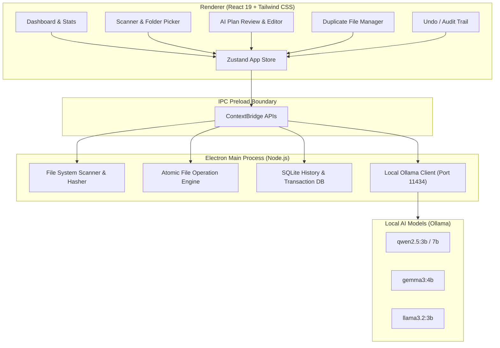

# 🗂️ TidyDesk AI — Privacy-First AI Desktop File Organizer

[](https://dev.to/challenges/hacktoberfest-week3-2026-10-19)
[](LICENSE)
[](https://www.electronjs.org/)
[](https://react.dev/)
[](https://www.typescriptlang.org/)
[](https://ollama.ai/)
[](src/tests)

> **"Drop the mess. Let AI organize it."**  
> *A privacy-first desktop application that transforms cluttered Downloads, Desktop, and Document directories into clean, structured systems using local open-weight LLMs — zero data leaves your machine.*

---

## 🌟 Overview

Cluttered Downloads and Desktop folders drain developer focus, waste disk storage with duplicated files, and make locating critical invoices, research notes, and project deliverables tedious.

**TidyDesk AI** combines **deterministic file pattern heuristics** with **local open-weight AI models** (via Ollama) to categorize, normalize, and organize files safely:

1. **🔒 100% Privacy Guarantee**: All file scans, hash computations, and LLM reasoning happen strictly on your local hardware. No files, metadata, or telemetry are ever sent to remote cloud servers.
2. **🧠 Hybrid Intelligence**: Instant rule-based classification for standard media types and development files, coupled with semantic LLM inference (`qwen2.5`, `gemma3`, `llama3.2`) for ambiguous documents and notes.
3. **🛡️ Safe Review & Approval**: TidyDesk AI never moves or alters a file without explicit user approval. Preview paths, rename targets, and confidence badges before applying.
4. **↩️ Complete One-Click Undo**: Every operation is logged atomically in a local SQLite database, allowing any action to be reversed instantly.
5. **🔍 Duplicate Detection**: Identifies redundant downloads through both exact SHA-256 cryptographic hashing and name/size heuristics.

---

## 🏛️ System Architecture



---

## 🚀 Key Features

| Feature | Description |
|---|---|
| **Deep Directory Scanning** | Recursively or flat-scans any directory, calculating file sizes, extensions, MIME types, and sample snippets. |
| **Deterministic Heuristics** | Instant classification into Code, Images, Audio, Videos, Archives, Invoices, and Resumes without waiting on LLMs. |
| **Semantic AI Classification** | Analyzes content snippets of PDFs, text notes, and documents using local Ollama models with customizable prompts. |
| **Confidence Scoring** | Displays confidence ratings (High / Medium / Low) for each AI suggestion so you know where human review is needed. |
| **Safe Batch Operations** | Collision-safe renaming and file movement (`file (1).ext`) to guarantee no file is ever overwritten accidentally. |
| **Cryptographic Hash Duplicates** | SHA-256 hash detection pinpoints exact byte-for-byte duplicate downloads cluttering your drive. |
| **SQLite Audit Trail** | Persistent transaction log of every file movement with one-click reversible undo. |
| **Offline-First Resilience** | Works smoothly even when Ollama is offline by gracefully falling back to deterministic classification rules. |

---

## 🛠️ Tech Stack

- **Runtime & Desktop Framework**: Electron 45, Node.js 24
- **Frontend & UI**: React 19, TypeScript, Tailwind CSS, Vite 8
- **State Management**: Zustand with Immer middleware
- **Local Database**: Better-SQLite3 for persistent ACID audit trails
- **AI Inference Engine**: Ollama (Local REST API on `localhost:11434`)
- **Supported Models**: `qwen2.5:3b` (Default recommended), `qwen2.5:7b`, `gemma3:4b`, `llama3.2:3b`
- **Testing**: Vitest, React Testing Library, JSDOM

---

## 🏁 Getting Started

### Prerequisites

1. **Node.js** (v18 or newer) and **npm**
2. **Ollama** installed on your system:
   ```bash
   # Download from https://ollama.ai/download or install via terminal:
   # Linux / macOS
   curl -fsSL https://ollama.com/install.sh | sh

   # Pull recommended lightweight model:
   ollama pull qwen2.5:3b
   ```

### Installation

```bash
# Clone the repository
git clone https://github.com/your-org/tidydesk-ai.git
cd tidydesk-ai

# Install dependencies
npm install
```

### Running Locally

```bash
# Start Vite dev server + Electron desktop app concurrently
npm run dev
```

Or run individual targets:
```bash
# Web UI only (Browser view on http://localhost:5173)
npm run dev:vite

# Electron wrapper only
npm run dev:electron
```

### Running Tests & Linting

```bash
# Run 44 automated Vitest tests
npm run test

# Run Oxlint code analysis
npm run lint

# Compile production bundle
npm run build
```

---

## 📁 Suggested Directory Hierarchy Created by AI

When TidyDesk AI reorganizes your folders, it creates clean, standardized categories:

```
📂 Organized Folder/
├── 📁 Code/
│   ├── 📁 Python/
│   ├── 📁 TypeScript/
│   └── 📁 Scripts/
├── 📁 Documents/
│   ├── 📁 Invoices/
│   ├── 📁 Career/
│   ├── 📁 Assignments/
│   ├── 📁 Academic/
│   └── 📁 Spreadsheets/
├── 📁 Images/
│   ├── 📁 Screenshots/
│   └── 📁 Icons/
├── 📁 Videos/
├── 📁 Audio/
├── 📁 Archives/
└── 📁 Miscellaneous/
```

---

## 🔐 Security & Privacy Policy

TidyDesk AI was engineered specifically for security-conscious developers and professionals:

- **Zero Cloud Communication**: The application has no tracking, no analytics, and no remote API calls. All network calls are strictly bound to `http://localhost:11434` (local Ollama instance).
- **Context Isolation & Sandbox**: Electron runs with `contextIsolation: true`, `nodeIntegration: false`, and strict IPC channels via `preload.ts`.
- **Atomic Operations**: Destination directory paths are verified, collision names are automatically incremented, and original files are verified before removal.
- **Rollback Protection**: If an operation fails mid-batch, the error is trapped, logged, and unaffected files remain in their original state.

---

## 🏆 Hacktoberfest Week 3 Challenge Alignment

This project was built from scratch for the **Hacktoberfest Open-Source AI Challenge Week 3: Slow and Steady** ([Challenge Details](https://dev.to/challenges/hacktoberfest-week3-2026-10-19)):

- **Theme Alignment**: Focuses on high-quality, privacy-first local AI desktop utility.
- **Genuine Utility**: Solves real daily clutter with reproducible, production-ready code.
- **100% Open Weights**: Utilizes local Ollama open models without proprietary lock-in.

---

## 📄 License

This project is licensed under the [MIT License](LICENSE).
